# Predicting Bank Term Deposit Subscription: A Leakage-Aware Machine Learning and Customer Targeting Study

MSI5001 academic project. Reporting source: merged main `92cac1f` and the preserved Phase 2C–7 artifacts. Phase 8 adds development-only descriptive explanations and aggregate reporting; it does not retrain models or repeat held-out evaluation. P1 remains the sole primary academic scenario. **Every predictor is Provisional: these results are conditional historical research, not verified deployment-ready pre-campaign targeting.**

## 1. Abstract

This study predicts historical subscription to a bank term deposit and examines how predictive ranking can support limited-capacity telemarketing prioritization. The supplied Portuguese-bank dataset contains 41,188 rows and 19 predictors plus a binary outcome; approved cleaning produces 41,176 rows and 15 predictors. Subscribers represent 11.2663% of cleaned records. A saved stratified assignment reserves 32,940 development and 8,236 held-out observations. Complete model pipelines fit encoding/scaling within training partitions; nested cross-validation evaluates approved hyperparameter-search procedures. Logistic Regression (LR), Decision Tree (DT), Random Forest (RF) and HistGradientBoosting (HGB) are compared, followed by threshold-policy, class-imbalance and feature-availability sensitivity studies.

Original full-feature HGB is the sole primary scenario. Its nested development AP is 0.448145 and final held-out AP is **0.451334** (descriptive bootstrap interval 0.420577–0.485339); held-out ROC-AUC is **0.807608** (0.790575–0.824540). At the illustrative top-10% capacity, 824 selected records include **412 historical subscribers**, yielding precision 0.500000, recall 0.443966 and predictive lift 4.437500. Customer-only HGB has held-out AP 0.230981. Balanced HGB offered small, capacity-dependent development gains, while undersampling generally reduced ranking quality.

New explanations use only development data and frozen models. Ten-repeat permutation analysis and validated raw-log-odds TreeSHAP indicate substantial macroeconomic reliance. These are in-sample descriptive findings, not independent estimates of feature contribution. Missing customer identifiers, campaign timestamps, input vintages and outcome-window metadata prevent verified campaign-start or future-campaign claims. Historical subscriber identification is not causal marketing uplift or financial ROI.

## 2. Introduction and business motivation

Banks have finite outreach resources and benefit from deciding which eligible customers to contact first. The documented problem is to predict subscription before the current campaign starts [1,2]. A ranking can identify a historically enriched group at a specified capacity, whereas a fixed probability cutoff determines a variable contact count. The operational question is therefore distinct from merely maximizing classification accuracy.

The supplied records describe an existing marketing population, not a randomized outreach experiment. A customer who subscribed after a historical contact might have subscribed without that contact; a predictive model cannot infer incremental response from these labels. This report separates subscription-propensity ranking, decision-policy trade-offs, and the evidence required for actual pre-campaign use. The study's top-10% capacity is illustrative, not an established bank constraint.

## 3. Research objectives

The objectives are to: (i) establish a majority-class and LR baseline under imbalance; (ii) compare approved model families using consistent partitions and training-only preprocessing; (iii) evaluate AP-selected tuning with an outer validation layer; (iv) distinguish ranking quality from threshold-dependent precision/recall; (v) test rather than assume benefits from class weighting/undersampling; (vi) quantify sensitivity to economic/history information; (vii) freeze a primary scenario and evaluate a held-out cohort once; and (viii) explain frozen-model reliance without causal or deployment claims. No fairness, causal effect, profitability or prospective operational effectiveness study was performed.

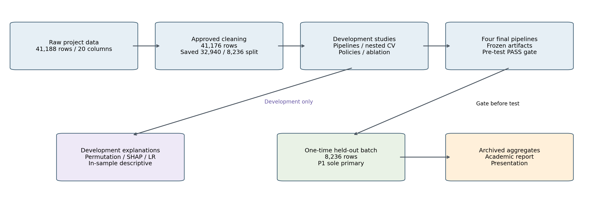

**Figure 1.** Research workflow: development modeling/explanations and separately gated one-time held-out evaluation. Source: Approved Phases 2C–8; schematic, not a new experiment.

## 4. Dataset and target definition

The raw file has **41,188 ×20** dimensions: 19 predictors and `y`. The README headline describes 21 columns, but its detailed field list and actual approved inspection show 20; no extra field was invented [1,3]. Original class counts were 36,548 non-subscribers and 4,640 subscribers. After 12 approved exact-duplicate removals, counts are 36,537 and 4,639. The target codes are 0=no and 1=yes, with no unknown target observed. These are archived Phase 1/2 counts, not a new held-out inspection.

| Partition / approved state | Records | Non-subscribers | Subscribers | Subscription percentage |
| --- | ---: | ---: | ---: | ---: |
| Raw dataset | 41,188 | 36,548 | 4,640 | 11.2654% |
| Cleaned dataset | 41,176 | 36,537 | 4,639 | 11.2663% |
| Saved development | 32,940 | 29,229 | 3,711 | 11.2659% |
| Held-out, as archived after approved evaluation | 8,236 | 7,308 | 928 | 11.2676% |

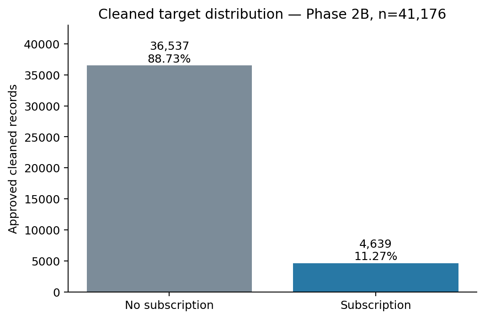

**Figure 2.** Approved cleaned class counts from Phase 2B; no new inspection of held-out rows. Source: 02_data_cleaning_summary.md; archived counts.

The seven customer attributes are age, job, marital, education, default, housing and loan. Prior-history inputs are previous, recency_available and recency_days. Economic inputs are emp.var.rate, cons.price.idx, cons.conf.idx, euribor3m and nr.employed. The bank's campaign-start definition, row unit/customer identity, target observation horizon and follow-up/censoring are not established by the supplied files. Accordingly, `y` is treated as the supplied historical binary subscription outcome, not a verified prospective response within a newly invented horizon.

## 5. Data cleaning and feature engineering

Approved Phase 2B cleaning removed **12 exact rows beyond the first occurrence**: 11 negatives and one positive [3]. Without customer IDs, exact duplicates cannot prove repeated customer identity or data-entry error. Removal was an approved methodological choice; it does not establish customer-disjoint evaluation. Legitimate ages 17–98, nonnegative previous-contact counts, rare categories and negative economic rates/index values were retained.

Unknowns were preserved as explicit categories. For default/housing/loan, deterministic relabelling maps -1→unknown, 0→no and 1→yes; this is not learned imputation or numerical encoding. Job, marital and education retain their text labels. The high unknown share in default was not treated as a reason to discard roughly one-fifth of observations. Missingness mechanism and recording time remain unknown.

| feature | cleaned_unknown | cleaned_percent |
| --- | --- | --- |
| job | 330 | 0.801438 |
| marital | 80 | 0.194288 |
| education | 1730 | 4.201477 |
| default | 8596 | 20.876239 |
| housing | 990 | 2.404313 |
| loan | 990 | 2.404313 |

Original pdays is replaced by **recency_available=1 iff pdays!=999**, with recency_days=pdays when available and 0 otherwise. The zero placeholder is distinguished from actual zero-day intervals by the indicator. All **4,110** rows with previous>0 and pdays=999 remain: unavailable recency does not imply never contacted. No 999 is treated as elapsed days. The actual recency range is 0–27 days; no new temporal or interaction features were introduced.

Duration was excluded because call length is unavailable before the call. Campaign counts include current-campaign activity; contact/month/day_of_week describe last/current-contact context and were also excluded for the pre-start objective. Original pdays is excluded as a direct predictor after its deterministic representation. These choices reduce obvious timing exposure but do not verify the 15 retained variables.

## 6. Experimental design and leakage controls

The hash-bound cleaned CSV is assigned once using stratified 80/20 sampling, random_state=42. `03_split_indices.json` stores ordered zero-based cleaned-file positions. Development has 32,940 rows; held-out has 8,236. A SHA-256 match binds content and row order. These positions are not customer IDs and do not establish chronology. The original dataset, cleaning, split and preprocessing module remain unchanged [4].

Six categorical fields use full OneHotEncoder(drop=None, handle_unknown='ignore', sparse_output=False). Observed unknown is a retained category; an unseen fitting-absent level becomes an all-zero block. LR uses StandardScaler for ordinary quantitative columns and the approved ConditionalRecencyScaler for recency_days: mean/population SD are learned only where recency_available=1, unavailable transformed days stay zero, and the indicator is unscaled. Zero/one/constant-observation fallbacks use safe unit scaling. Tree ensembles receive unscaled quantitative/recency values and numeric one-hot indicators.

Every candidate fold owns a fresh complete preprocessing/classifier pipeline. No whole-development encoded or scaled matrix is passed to CV. Stage 5A uses five stratified shuffled outer folds (seed 42), and five identical inner folds per outer-training partition for AP selection. Outer training=26,352; outer validation=6,588. Later final fitting legitimately refits the selected pipeline on all development after selection, without held-out inputs.

Model-family/grid exploration already examined development outcomes, and initial EDA used the full dataset. Thus neither nested CV nor the final holdout is described as a pristine independent external study never previously viewed. Direct fitting/selection contamination is controlled, but time/customer overlap and prior exploratory exposure remain limitations.

Metrics use positive class 1. AP is sklearn Average Precision (not trapezoidal PR area), summarizing precision along the ranked recall sequence. ROC-AUC measures score discrimination across positive/negative pairs. Accuracy=(TP+TN)/N; precision=TP/(TP+FP); recall=TP/(TP+FN); F1 is their harmonic mean. At zero predicted positives, precision/recall/F1 follow the declared zero_division=0 convention. The classification reference is probability>=0.50, not an optimized operating cutoff.

## 7. Baseline and candidate models

The majority-class Dummy baseline achieves accuracy **0.887341** while precision, recall and F1 are all zero; ROC-AUC is 0.5 and AP 0.112659. This demonstrates why high accuracy is insufficient under an approximately 11.27% positive rate [5]. Untuned LR improves AP to 0.422181, ROC-AUC to 0.762279 and F1 to 0.306015, but .50 recall remains 0.197520.

LR provides regularized linear log-odds structure; DT exposes rules but an unpruned tree may be unstable/overfit; RF averages randomized trees; HGB uses boosted trees for nonlinear relationships/interactions. Complexity is not presumed beneficial. Default weights are None and initial policies use .50. HGB uses early_stopping=False and categorical_features=None with numeric one-hot output. Models and initial grids were approved before these final comparisons [6,7].

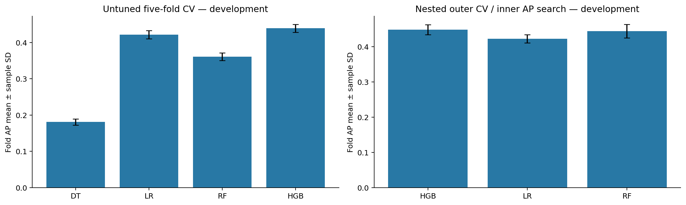

**Figure 3.** Untuned CV and nested CV are separate designs; no nested DT estimate exists; sample SD is not a significance test. Source: Phases 4/4B and 5A approved summary means.

## 8. Hyperparameter tuning and nested cross-validation

The consolidated table deliberately preserves design labels. Untuned entries are five-fold score means. Tuning-selected entries reuse selection folds and may be optimistic. Nested entries evaluate an inner search on outer validation; DT has no Phase 5A nested estimate. Sample SD describes five dependent folds, not an independent confidence interval.

| Design / source | Model | AP mean ± sample SD | ROC-AUC mean ± sample SD |
| --- | --- | --- | --- |
| Untuned five-fold OOF — Phase 4 | DecisionTree | 0.180763 ± 0.008793 | 0.619816 ± 0.011450 |
| Untuned five-fold OOF — Phase 4 | LogisticRegression | 0.422181 ± 0.011316 | 0.762279 ± 0.012382 |
| Untuned five-fold OOF — Phase 4 | RandomForest | 0.361307 ± 0.010715 | 0.760706 ± 0.007271 |
| Untuned five-fold OOF — Phase 4B | HistGradientBoosting | 0.439412 ± 0.010735 | 0.789919 ± 0.008285 |
| Nested outer CV, inner AP tuning — Phase 5A | HistGradientBoosting | 0.448145 ± 0.014219 | 0.794911 ± 0.011816 |
| Nested outer CV, inner AP tuning — Phase 5A | LogisticRegression | 0.422429 ± 0.011606 | 0.761875 ± 0.012192 |
| Nested outer CV, inner AP tuning — Phase 5A | RandomForest | 0.443930 ± 0.018936 | 0.790424 ± 0.010734 |
| Selected tuning-CV, potentially optimistic — Phase 4 | DecisionTree | 0.420499 ± 0.016574 | 0.771797 ± 0.007445 |
| Selected tuning-CV, potentially optimistic — Phase 4 | LogisticRegression | 0.422429 ± 0.011606 | 0.761875 ± 0.012192 |
| Selected tuning-CV, potentially optimistic — Phase 4 | RandomForest | 0.445417 ± 0.016226 | 0.791376 ± 0.011315 |
| Selected tuning-CV, potentially optimistic — Phase 4B | HistGradientBoosting | 0.448069 ± 0.015163 | 0.794969 ± 0.012023 |

HGB nested AP 0.448145 exceeds RF 0.443930 by **0.004215** and LR 0.422429 by 0.025716. HGB leads AP in four outer folds; RF leads in one. The HGB/RF difference is small relative to fold spread and does not establish statistical significance [8]. Pooled nested top-10% development capture is HGB 1,628, RF 1,588 and LR 1,564 among 3,294 contacts; pool diagnostics combine differently fitted models, so fold-local targeting is also important.

The final approved grids are HGB learning_rate=[0.05, 0.1], max_iter=[100,200], max_leaf_nodes=[15,31], l2_regularization=[0,1] and LR C=[0.1,1,10], lbfgs/default L2, max_iter=1000. Fixed seeds are 42 and weights None. AP is computed from positive-class predict_proba; ties use the first exact-mean winner in ParameterGrid order. RF/DT remain historical comparisons; no new family search or test-driven grid expansion occurs.

Phase 5A measured HGB nested searches/refits around 403.88s, RF 395.84s and LR 7.88s on its audited runtime. Phase 6A's eight procedures took approximately 1,512.60s. These are contextual timings including audit/scoring overhead, not portable hardware benchmarks or proof of optimal deployment efficiency.

## 9. Threshold optimization and class-imbalance treatments

Phase 5B-1 selected thresholds on training-side OOF probabilities within each outer-training partition and froze them before outer evaluation. This evaluates a selection procedure, not a globally optimized threshold on validation labels [9].

| Model | Policy | Precision mean ± SD | Recall mean ± SD | F1 mean ± SD |
| --- | --- | --- | --- | --- |
| HistGradientBoosting | Reference_0.50 | 0.667746 ± 0.015987 | 0.218813 ± 0.014761 | 0.329222 ± 0.014903 |
| HistGradientBoosting | Training_F1 | 0.428506 ± 0.014222 | 0.586634 ± 0.025850 | 0.495146 ± 0.016996 |
| HistGradientBoosting | Training_Precision50 | 0.527200 ± 0.013837 | 0.379681 ± 0.008766 | 0.441264 ± 0.004494 |
| LogisticRegression | Reference_0.50 | 0.686925 ± 0.025841 | 0.193749 ± 0.009698 | 0.302069 ± 0.011779 |
| LogisticRegression | Training_F1 | 0.438715 ± 0.012656 | 0.500136 ± 0.014471 | 0.467336 ± 0.011666 |
| LogisticRegression | Training_Precision50 | 0.531257 ± 0.020313 | 0.330098 ± 0.012439 | 0.407013 ± 0.012233 |

HGB training-F1 selection raises recall from 0.218813 to 0.586634 and F1 from 0.329222 to 0.495146, while precision falls from 0.667746 to 0.428506. Mean contact rate rises from 3.70% to 15.43%. LR F1 similarly rises from 0.302069 to 0.467336. AP and ROC-AUC do not change when only the threshold changes because the ranking scores are unchanged. The empirical training precision>=50% policy selected .35 in all original-model folds, but its validation success is not a future precision guarantee. Learned full-feature cutoffs were not transplanted into final reduced-feature models.

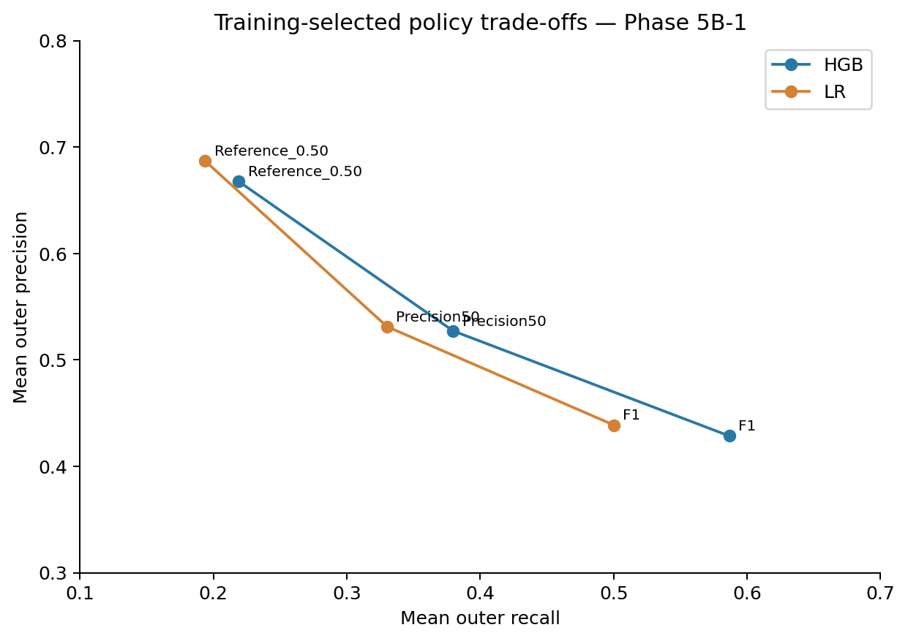

**Figure 4.** Frozen training-selected threshold policies evaluated on outer validation; connected points are policies, not an optimized test curve. Source: 07_threshold_decision_summary.md; development outer-fold means.

Phase 5B-2 compared identical model-family selection budgets across original, balanced class-weight and RandomUnderSampler treatments. All preprocessing/sampling stayed in fitting partitions; validation prevalence remained unchanged [10].

| Model | Original | Balanced | RandomUnderSampler |
| --- | --- | --- | --- |
| HGB | 0.448145 ± 0.014219 | 0.450883 ± 0.015341 | 0.436259 ± 0.019079 |
| Logistic Regression | 0.422429 ± 0.011606 | 0.420526 ± 0.011461 | 0.419671 ± 0.012471 |

Balanced HGB's mean AP advantage was **0.002738**, but pooled capture changes versus original were **+13/-18/-6** at top 5%/10%/20%. HGB undersampling reduced AP by 0.011886 and captured **17/50/29 fewer** subscribers at the same capacities. Original HGB's F1-selected F1=0.495146 exceeded balanced=0.491954 and undersampled=0.489511. Both LR treatments lowered mean AP. Therefore imbalance correction was not automatically retained.

Weighted/resampled F1 rules hit the .60 grid boundary and no candidate in .10–.60 met the illustrative precision constraint; the declared fallback abstained. This is grid-limited nonfeasibility, not proof higher thresholds could not work. No post-test threshold expansion or calibration was performed. SMOTENC was considered but deferred; ordinary SMOTE on full one-hot matrices was not used.

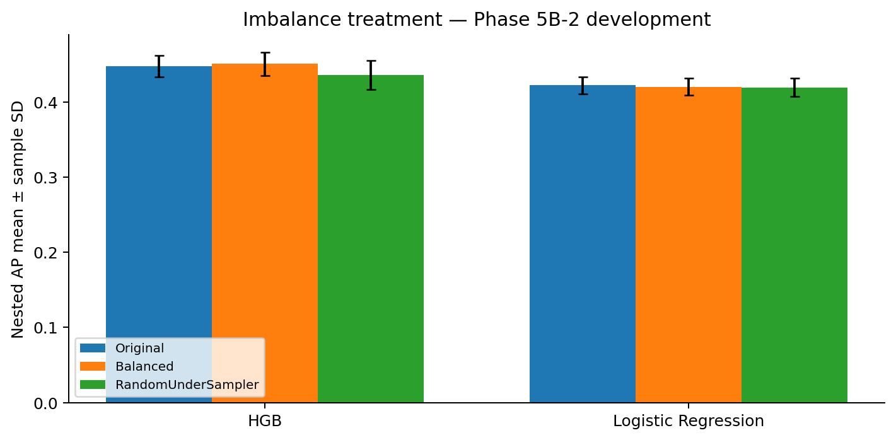

**Figure 5.** Symmetric-grid nested imbalance-treatment comparison; small balanced-HGB gain is not a significance conclusion. Source: 08_imbalance_treatment_summary.md.

## 10. Feature ablation and availability assessment

Four user-prespecified groups were independently tuned within nested CV [11]: Full 15; No Economic Indicators 10; No Previous Campaign History 12; and Customer Attributes Only 7. Full includes the seven customer fields, previous and both recency fields, and five economic indicators listed in Section 4. No Economics removes only those five; No History removes previous/recency_available/recency_days; Customer Only removes both groups. No excluded feature is replaced with zero columns; the recency transformer disappears entirely when history is absent.

| feature_group | predictors | HGB AP mean ± sample SD | LR AP mean ± sample SD |
| --- | --- | --- | --- |
| Full | 15 | 0.448145 ± 0.014219 | 0.422429 ± 0.011606 |
| No Economic Indicators | 10 | 0.351146 ± 0.015153 | 0.334394 ± 0.021340 |
| No Previous Campaign History | 12 | 0.389129 ± 0.009401 | 0.355256 ± 0.013265 |
| Customer Attributes Only | 7 | 0.232569 ± 0.009506 | 0.202251 ± 0.015223 |

HGB full-minus-subset AP losses are **0.096999** without economics, **0.059017** without history and **0.215576** customer-only. They are not additive feature contributions because groups share information and models are refit. HGB remains ahead of LR by mean AP in each group. At pooled development top 5%, HGB without economics captures 947 versus no-history 869 despite lower overall AP; at top 20%, no-history captures 2,356 versus Full 2,377, whereas no-economics captures 1,707. Overall AP alone does not determine every capacity-specific comparison.

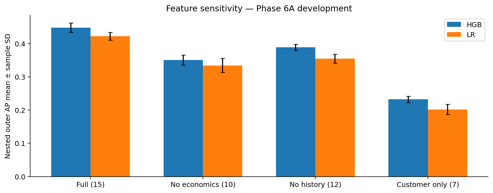

**Figure 6.** Each prespecified subset independently tuned in nested CV; ablation does not certify feature availability. Source: 09_feature_ablation_summary.md.

The feature contract keeps **all 15 Provisional** [12]. Customer snapshots need effective/availability dates; history needs prior-campaign boundaries and cutoff; recency needs its reference timestamp; economic inputs need period, first-release and revision-vintage/as-of evidence. The quarterly/monthly/daily frequencies in README do not establish availability at campaign start. Missing t0 and outcome-window definitions also matter.

If customer/history evidence were verified but economics were not, No Economics is a conditional candidate; if customer/economic evidence were verified but history were not, No History is an alternative. Customer Only reduces source requirements but still requires its seven snapshots and label contract. None is certified time-safe by ablation. The final held-out roster was fixed before testing, so the middle two groups were not added afterward.

## 11. Final model-selection protocol and held-out results

The approved roster is **P1 Full original HGB (sole primary)**, S1 customer-only original HGB sensitivity, B1 Full original LR benchmark and B2 customer-only LR benchmark [12,13]. Full P1 is conditional historical academic evaluation because timing remains unverified. All use no class weighting/resampling/calibration and fixed .50 classification reference. Primary predictive metric is AP, secondary ROC-AUC; the primary illustrative business capacity is top 10%, with 5%/20% predefined secondary.

| Scenario | Model | Features | Selected parameters | Development CV AP (selection only) |
| --- | --- | --- | --- | --- |
| P1 | HistGradientBoosting | 15 | {"classifier__l2_regularization": 1.0, "classifier__learning_rate": 0.05, "classifier__max_iter": 200, "classifier__max_leaf_nodes": 15} | 0.448069 |
| S1 | HistGradientBoosting | 7 | {"classifier__l2_regularization": 0.0, "classifier__learning_rate": 0.05, "classifier__max_iter": 100, "classifier__max_leaf_nodes": 15} | 0.233785 |
| B1 | LogisticRegression | 15 | {"classifier__C": 0.1} | 0.422429 |
| B2 | LogisticRegression | 7 | {"classifier__C": 0.1} | 0.202251 |

The final development-only search used **190 candidate-fold fits plus four final development refits =194 fits**. Its best-CV scores above are selection estimates. Before any test parser call, all four complete pipelines were serialized, digest-recorded and trusted reloads reproduced development-fixture probabilities exactly. The saved release gate states **PASS — All requirements satisfied** and precedes the test-access marker. Source/code/model/split hashes, correct class mapping, fitting-only transformations, correct recency, no unexpected warnings and four preprocessing tests were checked [13].

One authorized batch parsed the saved 8,236 held-out rows once and generated all four vectors before calculating metrics. No test fitting, category/scaler update, dropped rows, calibration or threshold selection occurred. Phase 8 reads only the archived aggregate tables; it does not reopen row-level predictions or recompute held-out evaluation.

| Scenario | Role | AP [descriptive 95% interval] | ROC_AUC [descriptive 95% interval] |
| --- | --- | --- | --- |
| P1 | Sole Primary | 0.451334 [0.420577, 0.485339] | 0.807608 [0.790575, 0.824540] |
| S1 | Secondary Sensitivity | 0.230981 [0.211086, 0.254719] | 0.669764 [0.651039, 0.687616] |
| B1 | Secondary Benchmark | 0.431032 [0.400841, 0.463371] | 0.777331 [0.759071, 0.796171] |
| B2 | Secondary Benchmark | 0.200407 [0.183810, 0.221354] | 0.648536 [0.630318, 0.665504] |

Intervals are the recorded **2,000 paired stratified metric-bootstrap 95% percentile intervals**, seed 42, preserving observed class counts and sharing draws across scenarios without refitting. They condition on fitted models/class balance and do not cover model selection, client/time clustering, timing errors, prevalence shifts or future campaigns. Overlap/nonoverlap is not used to declare significance or reselect P1.

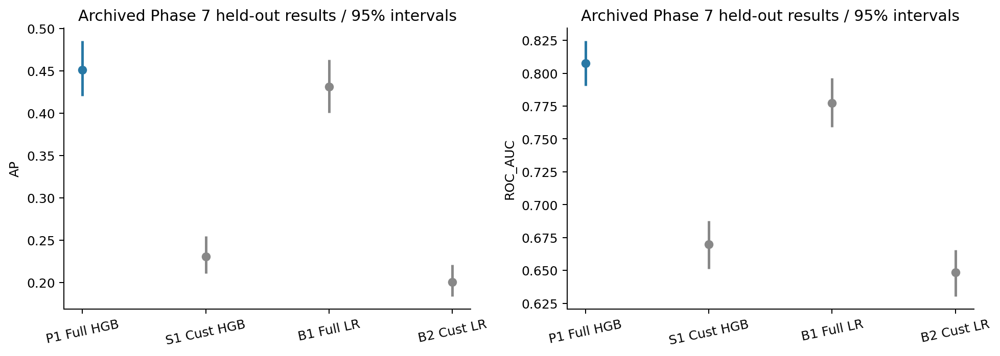

**Figure 7.** One-time held-out point estimates and conditional 95% paired-stratified bootstrap intervals; P1 remains primary. Source: Stored results/heldout_metrics.csv and bootstrap_intervals.csv; no test predictions rerun.

| scenario | Accuracy | Precision | Recall | F1 | predicted_positive_count | predicted_positive_fraction | TN | FP | FN | TP |
| --- | --- | --- | --- | --- | --- | --- | --- | --- | --- | --- |
| P1 | 0.896552 | 0.619497 | 0.212284 | 0.316212 | 318 | 0.038611 | 7187 | 121 | 731 | 197 |
| S1 | 0.887688 | 0.615385 | 0.008621 | 0.017003 | 13 | 0.001578 | 7303 | 5 | 920 | 8 |
| B1 | 0.898009 | 0.676000 | 0.182112 | 0.286927 | 250 | 0.030355 | 7227 | 81 | 759 | 169 |
| B2 | 0.887324 | 0.000000 | 0.000000 | 0.000000 | 0 | 0.000000 | 7308 | 0 | 928 | 0 |

Confusion matrices follow [[TN,FP],[FN,TP]]. Observed held-out prevalence is 928/8,236=0.112676. B2 predicts no positives at .50 and has majority-class accuracy 0.887324, yet AP 0.200407 indicates some ranking discrimination. P1 .50 precision 0.619497 coexists with recall 0.212284; no optimal threshold or business policy follows from this cutoff alone.

| scenario | previous_nested_AP_mean_SD | heldout_AP | test_minus_nested_mean |
| --- | --- | --- | --- |
| P1 | 0.448145 ± 0.014219 | 0.451334 | 0.003189 |
| S1 | 0.232569 ± 0.009506 | 0.230981 | -0.001588 |
| B1 | 0.422429 ± 0.011606 | 0.431032 | 0.008603 |
| B2 | 0.202251 ± 0.015223 | 0.200407 | -0.001844 |

P1 held-out AP is 0.003189 above its prior nested mean; B1 is 0.008603 above; S1/B2 are 0.001588/0.001844 below. These are descriptive apparent generalization differences, not evidence that test performance improved a model. Final estimators train on more development rows than individual outer models; partitions differ. HGB has higher held-out AP/AUC than LR within both feature sets, and Full exceeds Customer Only, but P1 remains primary by protocol, not by winning a test comparison. Random customer/time overlap limits any inference to future periods.

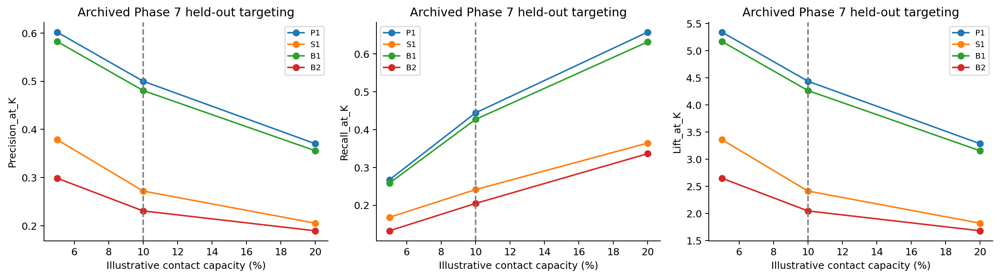

**Figure 8.** Fixed capacities 412/824/1648; top 10% is illustrative primary reporting, not a known bank requirement or causal uplift. Source: Stored results/heldout_topk.csv only.

## 12. Model explainability: frozen, development-only and in-sample

### 12.1 Design and global permutation reliance

Only trusted P1 and B1 artifacts were loaded after their recorded digests were verified. All fitting methods were blocked. A seed 42 development-only sample contains **5,000 records, 563 positives (11.26%)**, close to development prevalence 11.2659%. Its frozen P1 AP is **0.500152**. Because P1 already fitted every development row, this is **in-sample descriptive AP**, not new validation, a superior final performance result, or evidence of generalization.

Each raw input column was permuted through the full unchanged pipeline ten times. AP drop is baseline minus permuted AP. A repeat shares its permutation order across fields/groups; labels and prevalence stay fixed. SD across repeats is perturbation dispersion, not an independent confidence interval. The largest individual mean drops are nr.employed 0.176239±0.012367, emp.var.rate 0.118862±0.006869, euribor3m 0.084485±0.002679, recency_available 0.060935±0.010651 and age 0.046798±0.007833.

| feature_or_group | mean_AP_reduction | sample_SD |
| --- | --- | --- |
| nr.employed | 0.176239 | 0.012367 |
| emp.var.rate | 0.118862 | 0.006869 |
| euribor3m | 0.084485 | 0.002679 |
| recency_available | 0.060935 | 0.010651 |
| age | 0.046798 | 0.007833 |
| cons.conf.idx | 0.022663 | 0.002875 |
| education | 0.018104 | 0.003620 |
| job | 0.015972 | 0.001917 |
| previous | 0.013001 | 0.002083 |
| recency_days | 0.012304 | 0.002423 |
| marital | 0.009630 | 0.003388 |
| cons.price.idx | 0.008801 | 0.001909 |
| default | 0.006102 | 0.001679 |
| housing | 0.005735 | 0.001121 |
| loan | 0.004770 | 0.001441 |

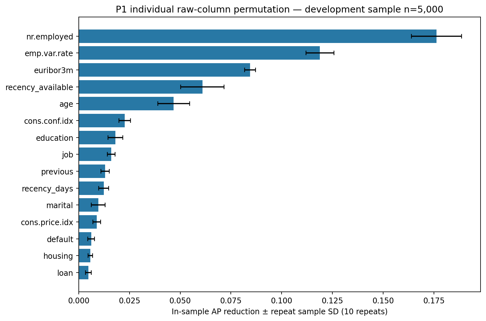

**Figure 9.** P1 individual raw-column permutation; development-only in-sample, ten repeats; SD is permutation dispersion, not a generalization CI. Source: Phase 8; frozen P1, no refitting.

| feature_or_group | mean_AP_reduction | sample_SD |
| --- | --- | --- |
| Economic indicators | 0.335810 | 0.011211 |
| Previous campaign history | 0.083725 | 0.012011 |
| Customer attributes | 0.072181 | 0.007798 |

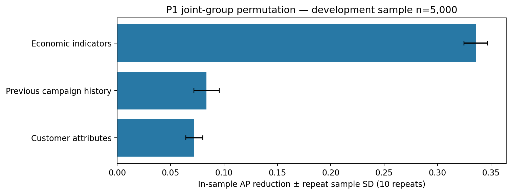

**Figure 10.** P1 joint-group permutation; development-only in-sample, ten repeats; SD is permutation dispersion, not a generalization CI. Source: Phase 8; frozen P1, no refitting.

Joint group permutation uses one row order for all included fields, preserving internal relationships. Economics dominate the frozen-model sensitivity, followed by history and customer attributes. Correlated variables can substitute/share information, so individual drops cannot be summed as the joint group effect. Individual recency permutations can break the valid day/availability pairing; their scores are perturbation sensitivities, not realistic customer interventions. Joint history is more coherent but still disrupts cross-group relationships.

These qualitative patterns agree with Phase 6A's need for economic/history information, but numerical magnitudes are not comparable: permutation changes the frozen model's inputs on an in-sample cohort, whereas ablation allows retraining/tuning and evaluates outer-fold performance. A group permutation drop 0.335810 is not an unbiased out-of-sample economic contribution or the same quantity as the no-economics AP loss 0.096999.

### 12.2 SHAP output semantics and mapping

SHAP 0.50.0 TreeExplainer supports the frozen binary HGB. It uses **tree_path_dependent** training-node cover and **raw positive-class log-odds** [15,16]. For 303 unique development observations, sums of base plus transformed contributions match decision_function with maximum error **5.33e-15**; the sigmoid matches pipeline positive probability with maximum error **1.17e-15**. These checks establish numerical attribution consistency, not causal validity.

Global summaries use 300 random rows (seed 42). Three predeclared high/middle/low probability examples are additionally included without outcome-based selection. Learned encoder categories and transformer order map all 42 transformed columns to the 15 original fields; names match the frozen manifest. One-hot contributions are **summed signed within each original field for each row**, then absolute values are averaged. This preserves local totals but is an aggregation of the encoded-feature game, not exact original-field coalition SHAP. Opposing dummy contributions can cancel; arbitrary sums of absolute dummy values are not presented as exact original-variable attribution.

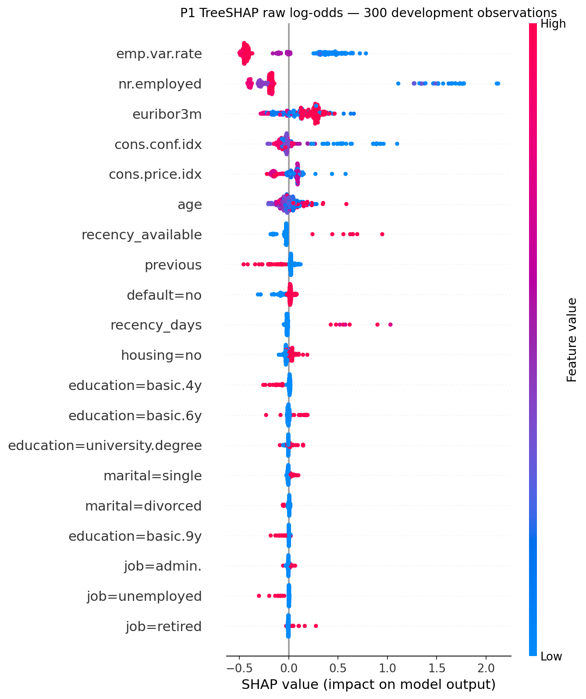

**Figure 11.** TreeSHAP encoded-feature beeswarm; raw log-odds for class 1; color is transformed feature value. Source: Phase 8; tree-path-dependent reference; development in-sample.

| feature | mean_abs_signed_group_logodds |
| --- | --- |
| emp.var.rate | 0.397556 |
| nr.employed | 0.376072 |
| euribor3m | 0.200518 |
| cons.conf.idx | 0.102447 |
| cons.price.idx | 0.096185 |
| age | 0.070380 |
| recency_available | 0.052469 |
| previous | 0.046534 |
| education | 0.042158 |
| default | 0.034844 |
| recency_days | 0.031156 |
| housing | 0.026034 |
| job | 0.024775 |
| marital | 0.015469 |
| loan | 0.006804 |

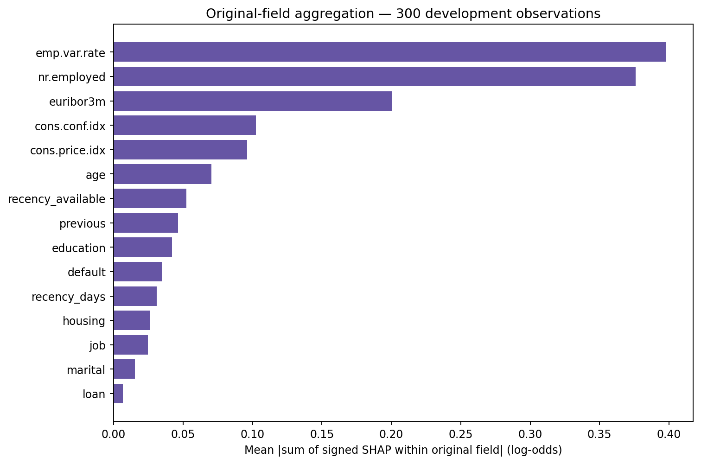

**Figure 12.** Mean absolute signed-within-field SHAP sums; encoded-game aggregation, not a recomputed original-variable Shapley game. Source: Phase 8; development in-sample.

The largest original-field aggregate mean absolute log-odds contributions are emp.var.rate 0.397556, nr.employed 0.376072 and euribor3m 0.200518. Their ordering differs slightly from permutation but both highlight macroeconomic reliance. The reference uses fitted training paths rather than an externally representative population; correlation and the encoded game affect attribution allocation.

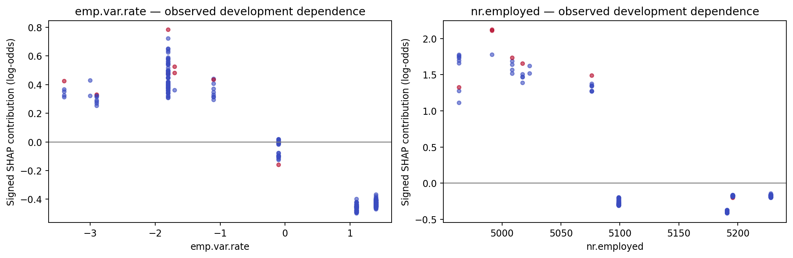

**Figure 13.** Observed numerical value versus signed original-field contribution; color indicates recency availability; associations, not intervention responses. Source: Phase 8; 300 development observations.

Observed emp.var.rate versus its signed contribution has Spearman association -0.7026 in this sample, while nr.employed has a weaker +0.2114. These are descriptive dependence associations, not derivatives, monotone laws or causal effects. Nonlinearity and correlated predictors can yield patterns different from LR's conditional coefficients. A SHAP plotting-only FutureWarning concerned global RNG seeding; current-run jitter was seeded42, and all attribution/additivity checks passed. It did not affect frozen models or create a compatibility failure.

### 12.3 Representative local explanations

| example | cleaned_row_position | predicted_probability | base_log_odds | sum_contributions_log_odds | reconstructed_probability | leading_signed_contributions |
| --- | --- | --- | --- | --- | --- | --- |
| high | 40181 | 0.859851 | -2.503824 | 4.317877 | 0.859851 | nr.employed: +2.1633; recency_available: +0.5566; emp.var.rate: +0.5145; recency_days: +0.4189; euribor3m: +0.2334 |
| medium | 18081 | 0.057087 | -2.503824 | -0.300582 | 0.057087 | emp.var.rate: -0.4434; euribor3m: +0.2317; nr.employed: -0.1661; cons.price.idx: +0.0845; age: +0.0440 |
| low | 1415 | 0.015950 | -2.503824 | -1.618390 | 0.015950 | emp.var.rate: -0.4452; nr.employed: -0.3898; loan: -0.2464; education: -0.2226; cons.price.idx: -0.1377 |

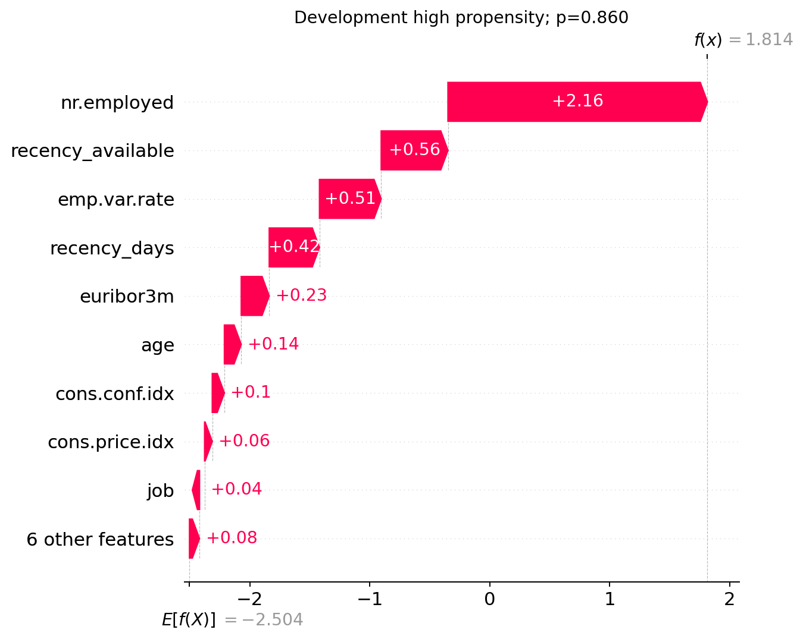

**Figure 14.** Local high predicted-propensity example chosen by predeclared score rank, not observed outcome; grouped signed log-odds contributions. Source: Phase 8; development only; no causal intervention.

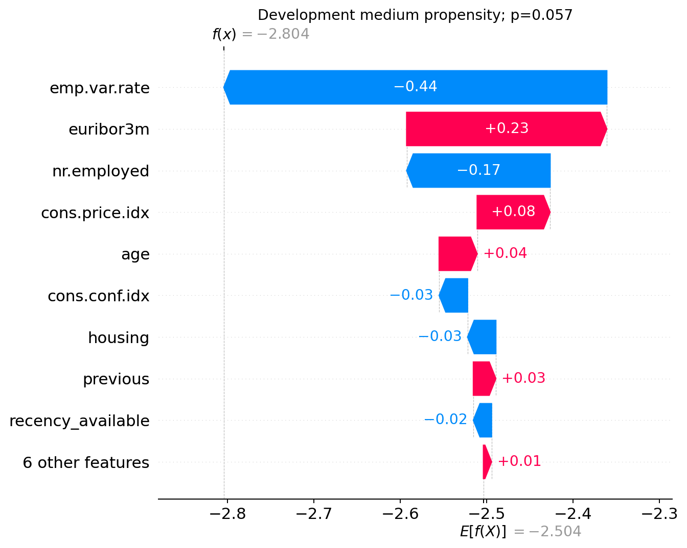

**Figure 15.** Local medium predicted-propensity example chosen by predeclared score rank, not observed outcome; grouped signed log-odds contributions. Source: Phase 8; development only; no causal intervention.

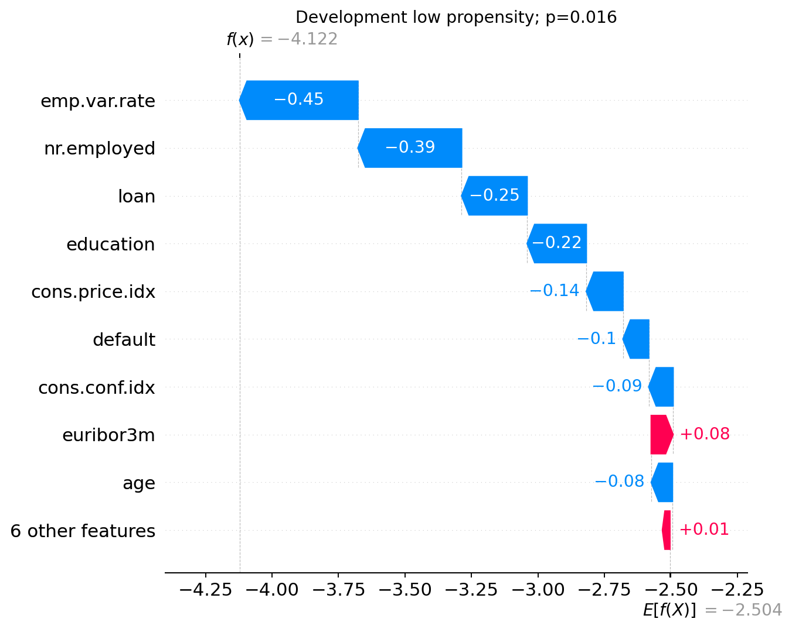

**Figure 16.** Local low predicted-propensity example chosen by predeclared score rank, not observed outcome; grouped signed log-odds contributions. Source: Phase 8; development only; no causal intervention.

Highest/middle/lowest score ranks are selected within the explanation sample, with cleaned-row position ties; observed subscription outcomes do not choose the examples. Probabilities are 0.859851, 0.057087 and0.015950. The common reference logit is approximately-2.503824. Signed original-field contributions reconstruct each prediction, but they do not explain why the person subscribed, identify a person, or show what changing one field would cause. Large macro/history contributions in the high example are descriptive model allocations, not actionable levers.

### 12.4 LR coefficient reference

B1's 42 coefficients align with transformed names; reconstructed dot-product logits and sigmoid probabilities match its frozen development outputs. Recency availability has coefficient +1.737389, emp.var.rate -0.640220 and nr.employed -0.378930. Numerical coefficients use training-standardized units; conditional recency's scale uses available observations only, and availability remains a separate binary bit.

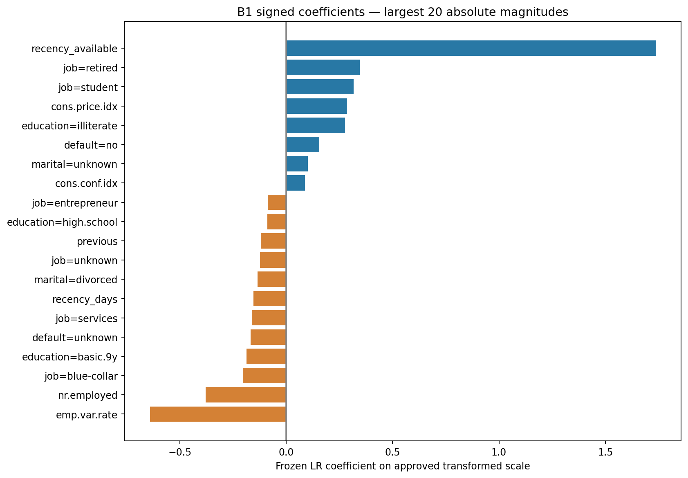

**Figure 17.** B1 coefficients on standardized numerical/full-one-hot scale; not causal effects or unadjusted original-unit importance. Source: Phase 8; frozen B1, alignment checked with development logits.

A sign describes conditional fitted log-odds holding other transformed inputs fixed. Full one-hot has no omitted category, so a valid category substitution uses coefficient differences and depends on L2 shrinkage/intercept convention. Rare categories such as education=illiterate (18 cleaned records) limit substantive interpretation of individual coefficients. Coefficients are not unadjusted original-unit importance, and correlated economics can redistribute signs/magnitudes. LR's linear conditional effects are a useful structural contrast with HGB, not a causal or universally interpretable benchmark. Complete coefficients, mappings, signed SHAP arrays, sample positions and diagnostics are saved under figures/data/ [14].

## 13. Business targeting analysis

The fixed-capacity policy orders class 1 scores descending, ties by immutable cleaned-row position, and selects K=ceil(fraction×N). Precision@K is the subscriber share among selected records; Recall@K is captured subscribers divided by all 928 archived test subscribers; Lift@K is precision divided by cohort prevalence. These quantities measure **historical subscription concentration**, not incremental response to outreach.

Primary illustrative top 10% results:

| scenario | fraction | capacity_role | contacts | captured_subscribers | Precision_at_K | Recall_at_K | Lift_at_K |
| --- | --- | --- | --- | --- | --- | --- | --- |
| P1 | 0.100000 | Primary illustrative | 824 | 412 | 0.500000 | 0.443966 | 4.437500 |
| S1 | 0.100000 | Primary illustrative | 824 | 224 | 0.271845 | 0.241379 | 2.412621 |
| B1 | 0.100000 | Primary illustrative | 824 | 396 | 0.480583 | 0.426724 | 4.265170 |
| B2 | 0.100000 | Primary illustrative | 824 | 190 | 0.230583 | 0.204741 | 2.046420 |

Predefined secondary top 5%/20% results:

| scenario | fraction | capacity_role | contacts | captured_subscribers | Precision_at_K | Recall_at_K | Lift_at_K |
| --- | --- | --- | --- | --- | --- | --- | --- |
| P1 | 0.050000 | Secondary | 412 | 248 | 0.601942 | 0.267241 | 5.342233 |
| P1 | 0.200000 | Secondary | 1648 | 610 | 0.370146 | 0.657328 | 3.285042 |
| S1 | 0.050000 | Secondary | 412 | 156 | 0.378641 | 0.168103 | 3.360437 |
| S1 | 0.200000 | Secondary | 1648 | 338 | 0.205097 | 0.364224 | 1.820237 |
| B1 | 0.050000 | Secondary | 412 | 240 | 0.582524 | 0.258621 | 5.169903 |
| B1 | 0.200000 | Secondary | 1648 | 586 | 0.355583 | 0.631466 | 3.155795 |
| B2 | 0.050000 | Secondary | 412 | 123 | 0.298544 | 0.132543 | 2.649575 |
| B2 | 0.200000 | Secondary | 1648 | 312 | 0.189320 | 0.336207 | 1.680218 |

See Figure 8 for the archived fixed-capacity curves.

P1's 824 selected records include 412 historical subscribers (50.00% precision, 44.40% recall, 4.44 predictive lift). Its fixed .50 cutoff selects 318 records and identifies 197 subscribers; expanding to an illustrative fixed capacity changes volume and precision/recall, not ranking ability. P1 top 5% identifies 248 among 412 (60.19% precision); top 20% identifies 610 among 1,648 (37.01% precision). Broader contact volume captures more historical subscribers at lower concentration here, but no cost-optimal choice is established.

Full HGB captures 188 more than customer-only HGB and 16 more than Full LR at top 10%; Customer HGB captures 34 more than Customer LR. These cohort comparisons do not estimate additional subscriptions caused by calls. A bank with limited outreach resources can enforce capacity directly with ranking, whereas a .50 rule may contact too few or too many. Actual capacity, contact costs, product value, treatment effects and operational constraints must be established before deployment or ROI analysis.

## 14. Discussion and practical implications

Three observations are supported. First, nonlinear HGB offers a measured ranking advantage over the simple LR reference in nested and held-out results, with only a small nested advantage over RF. Second, threshold changes substantially improve recall/F1 for a different contact-volume/precision trade-off without improving AP/ROC-AUC. Third, economic/history information contributes much of the available predictive signal, but its campaign-start eligibility is unverified.

The explainability results identify data-governance priorities rather than new model-development actions. Economic release/vintage provenance and history reference dates deserve scrutiny because the model relies on those fields. The customer-only sensitivity quantifies a stricter information requirement at a considerable AP cost; it is not automatically time-safe. No score should override the feature contract. The observed results do not justify a new primary scenario, untested subset, demographic intervention or post-test tuning experiment.

## 15. Limitations and threats to validity

1. **Feature timing and target definition:** no verified campaign-start snapshots, economic publication/revision vintages, prior-history cutoff, recency reference date or outcome window. Every retained predictor remains Provisional.
2. **Customer/time overlap:** missing IDs and timestamps prevent group/time separation and allow repeated-client/shared-period leakage across random partitions. Exact-duplicate removal does not establish unique clients.
3. **Exploratory/model-selection exposure:** early full-data EDA and repeated development-driven family/grid/shortlist choices limit independence. Nested CV evaluates fixed procedures but does not erase earlier research choices. The holdout is now exposed and cannot be recycled for new selection.
4. **Explanation validity:** development explanations are in-sample, sample-specific and reference-dependent. Marginal perturbations can create off-manifold/inconsistent combinations; tree-path SHAP allocates correlated/encoded information under a particular game. Importance is not proof of availability, fairness, robustness or causality.
5. **Statistical uncertainty:** fold SD is not a CI. Row-wise paired stratified bootstrap intervals condition on fitted models and class counts; they omit selection uncertainty, clustering, temporal overlap, prevalence change and prospective shift. No appropriate predeclared significance test establishes a winner.
6. **Business/causal scope:** observed subscriptions in a historical marketing cohort do not identify uplift from calls. No randomized treatment comparison, cost/value data, profit objective, capacity mandate or prospective deployment experiment exists. The top 10% budget is illustrative.
7. **Data provenance and reporting:** the original collection/publication/license metadata and author/date of local course documents are not supplied. Provided files and preserved hashes support reproducibility of this academic study, not provenance claims beyond them. Rare categories and substantial default unknowns constrain interpretation.

## 16. Conclusion and future work

The frozen primary Full HGB yields held-out AP 0.451334 and ROC-AUC 0.807608, with 412 historical subscribers among 824 top 10% selected records. Customer-only HGB AP 0.230981 shows a substantial information-requirement trade-off. Threshold-only strategies can improve recall/F1; class weighting offers only small inconsistent targeting gains and undersampling was not retained. Development explanations reinforce macroeconomic reliance but do not validate timing or causality.

The completed study supports a transparent **historical academic ranking comparison**, not deployment readiness. Future research should obtain verified as-of input/outcome contracts, identifiers/dates for grouped/forward-time evaluation, prospective validation, operational objectives and randomized or otherwise credible causal outreach evidence. Fairness and subgroup suitability require separate ethically justified investigation. Such work needs new authorization and appropriately independent evaluation data; it is not performed on this exposed holdout. No new training, held-out evaluation, tuning, commit or push occurred in Phase 8.

## 17. References

[1] Project repository. [README.md](README.md), “Bank Telemarketing Campaign Dataset Documentation.” Author/date and original dataset bibliographic provenance not supplied.

[2] MSI5001. `MSI5001 Project Bank Telemarketing .docx`, supplied planning notes. Author/date not supplied; no explicit final slide-count requirement was found.

[3] [Phase 2B data-cleaning summary](02_data_cleaning_summary.md) and [Phase 1 EDA summary](eda_summary.md). Approved project artifacts; counts, unknowns, deterministic recency and duplicate decisions.

[4] [Phase 2C preprocessing summary](03_preprocessing_summary.md), [preprocessing.py](preprocessing.py), [saved split manifest](03_split_indices.json).

[5] [Phase 3 baseline summary](04_baseline_summary.md).

[6] [Phase 4 model comparison summary](05_model_comparison_summary.md).

[7] [Phase 4B HGB summary](05b_hist_gradient_boosting_summary.md).

[8] [Phase 5A nested-CV and targeting summary](06_nested_cv_targeting_summary.md).

[9] [Phase 5B-1 threshold-decision summary](07_threshold_decision_summary.md).

[10] [Phase 5B-2 imbalance-treatment summary](08_imbalance_treatment_summary.md).

[11] [Phase 6A feature-ablation summary](09_feature_ablation_summary.md).

[12] [Phase 6B final selection plan](10_final_model_selection_plan.md) and [feature-availability matrix](10_feature_availability_matrix.md).

[13] [Phase 7 final summary](11_final_training_and_test_summary.md), [release gate](12_pre_holdout_release_gate.md), [model manifest](models/model_manifest.json), and stored aggregate results/intervals in results/.

[14] [Phase 8 explainability notebook](13_model_explainability.ipynb), [summary](13_model_explainability_summary.md), and figures/data/ reproducibility records.

[15] SHAP documentation, [TreeExplainer API](https://shap.readthedocs.io/en/latest/generated/shap.TreeExplainer.html). Software used here: SHAP 0.50.0; output semantics verified directly against frozen predictions.

[16] Lundberg, S. M., and Lee, S.-I. (2017). “A Unified Approach to Interpreting Model Predictions.” Advances in Neural Information Processing Systems 30. [arXiv:1705.07874](https://arxiv.org/abs/1705.07874).

[17] Pedregosa, F., et al. (2011). “Scikit-learn: Machine Learning in Python.” Journal of Machine Learning Research 12, 2825–2830. [JMLR paper](https://jmlr.org/papers/v12/pedregosa11a.html). Also see official [permutation-importance documentation](https://scikit-learn.org/stable/modules/permutation_importance.html); execution version 1.8.0.

**References to complete:** original dataset collection/publication/license and course-document authorship/date must be obtained from the data owner/course materials. No unverified dataset origin, collection period or invented business citation is substituted.
